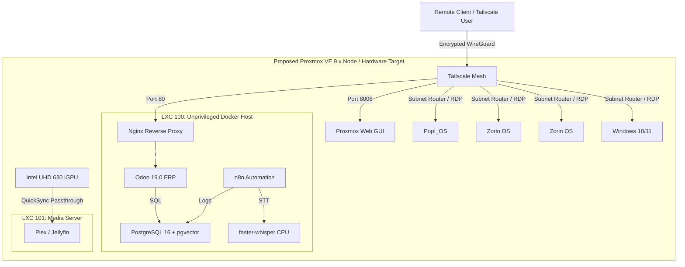

# pve-node-iac

  

> Design and Infrastructure as Code (IaC) artifacts for a proposed single-node Proxmox VE home lab, including host configuration, an unprivileged container layer, and an application deployment stack.

---

> ⚙️ **Status (October 2026): Superseded as a project — retained as a design reference.** This Proxmox VE home-lab design was never deployed or validated on real hardware, and the target hardware was never acquired. The infrastructure need this project was meant to serve is now met differently: a headless, AI-assisted workflow orchestrated through the Agora app — see [agora-pro-setup](https://github.com/painter99/agora-pro-setup). That approach covers the author's current needs; it does not implement every capability this design proposed (for example the multi-VM workstation layer or the media server).

---

## ⚠️ Important Disclaimer

This is a **personal design and learning project**. The proposed setup was never deployed or tested on real hardware, and the repository is kept as a reference, not as a running setup.

- **Educational value:** You may learn from the architecture, decisions, and patterns documented here.
- **Not production-ready:** Code and configuration may contain errors, omissions, or outdated assumptions.
- **No warranty:** There is no guarantee of correctness, safety, or fitness for any purpose.
- **Verify before use:** If you are an IT professional considering any of these patterns, review the canonical IaC files yourself and validate against your own environment.
- **Feedback welcome** but this project is not open for external contributions.

> See [MANUAL.md](MANUAL.md) for the unvalidated reference procedure and [docs/](docs/README.md) for the design rationale.

---

## 🏗️ Core Stack

> For a complete technology catalog, visit the [STACK_BADGES](STACK_BADGES.md) page.

---

## 🗺️ Visual Component Map

---

## 📄 Description and Context

The original design targeted a single-node Proxmox VE home lab on Dell Optiplex 3060-class hardware. It describes a virtual-machine layer alongside an application stack based on Odoo, PostgreSQL, automation, and media services, using unprivileged LXC containers, resource limits, and private-network access. The target hardware was never acquired for this project, and the design has not been validated on a deployed host.

IaC artefacts live as real files in `docker/`, `proxmox/`, and `scripts/`. Each major area keeps its own README so the knowledge graph can scale without overloading this root page.

---

## 🔗 System Links

| Area                               | Description                                                             |
| ---------------------------------- | ----------------------------------------------------------------------- |
| [MANUAL.md](MANUAL.md)             | Unvalidated reference procedure for the original hardware proposal       |
| [docs/](docs/README.md)            | Architecture, hardware, resource budget, host tuning, disaster recovery |
| [docker/](docker/README.md)        | Odoo + AI + PostgreSQL Compose stack (canonical)                        |
| [proxmox/](proxmox/README.md)      | LXC container profiles and Tailscale network configuration              |
| [scripts/](scripts/README.md)      | Host tuning and stack deployment automation                             |
| [archive/](archive/README.md)      | Legacy PoC notes, historical IaC drafts, hardware pivot rationale       |
| [STACK_BADGES.md](STACK_BADGES.md) | Technology badge catalog (shields.io)                                   |
